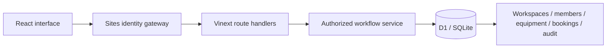

# BorrowLab

**Good things are better shared.** Equipment booking and handover management for campus labs, clubs, and creative teams.

Built by **Atharva Singh** for the End-Term Software Project.

- [Application](https://borrowlab-avsolos.nimblespoon35.chatgpt.site)
- [Source and commit history](https://github.com/AVsolos/mern-endterm)
- [Architecture and product decisions](docs/product-and-architecture.md)
- [Verification and limitations](docs/verification.md)
- [Demo script](docs/demo-script.md) · [Submission details](docs/submission-details.md)

## Problem statement and target users

A camera shared through a group chat has no reliable availability calendar, handover record, or clear return responsibility. Campus lab managers and student club members need a lightweight shared system that prevents conflicting bookings and tracks physical equipment from reservation to return.

## Solution and key features

BorrowLab organizes equipment into private team workspaces. The creator manages inventory and handovers; invited borrowers reserve equipment and manage their own bookings.

1. **Create or join a workspace.** Use ChatGPT sign-in, create a workspace, optionally load six sample assets, or join using a manager's invitation. Rotate invitations when necessary.
2. **Find and reserve equipment.** Search by name, tag, or location; filter categories and availability; choose a future time slot and explain the purpose. The database checks conflicts atomically before saving.
3. **Complete the loan.** Managers check equipment out and record returns with condition notes. Borrowers can cancel uncollected reservations. Overdue loans remain blocked until returned.
4. **Keep inventory trustworthy.** Add uniquely tagged assets, place equipment in maintenance only when commitments are resolved, and review a persistent activity trail.

This is a working database-backed application. Sample assets are created only on request in a new workspace and then behave as ordinary inventory. The interface does not hardcode bookings or success states.

## Try it as an evaluator

Open the application and sign in with ChatGPT. Create a workspace with sample equipment. Set pickup about five minutes ahead and return two hours later, then reserve a camera. Open **Reservations**, check out the camera, and record its return. Open **History** and **Activity**, then reload to verify persistence.

To test borrower permissions, copy the workspace invitation under **Workspace** and join from a second ChatGPT account. Borrowers see availability and their own reservations, cannot view the invitation/audit trail, and cannot manage inventory or handovers.

No author approval or shared administrator password is needed to create your own evaluator workspace. Hosted sign-in requires a ChatGPT account. Local testing uses the starter's development identity instead.

## Tech stack

| Component    | Choice                                                    | Why                                                                    |
| ------------ | --------------------------------------------------------- | ---------------------------------------------------------------------- |
| Interface    | React 19, TypeScript, CSS, Lucide icons                   | Typed interaction state and an accessible responsive interface         |
| Server       | Vinext/Vite on Cloudflare Workers                         | Route handlers and React rendering in one deployable app               |
| Persistence  | Cloudflare D1 / SQLite                                    | Relational constraints and atomic statements for resource reservations |
| Schema       | Drizzle and checked-in SQL migrations                     | Versioned and reproducible schema changes                              |
| Identity     | Sites / ChatGPT sign-in                                   | Verified identity at the hosting gateway without storing passwords     |
| Verification | Node test runner, real SQLite, TypeScript, GitHub Actions | Reproducible domain, authorization, transaction, and build checks      |

The repository name is `mern-endterm`, but this project does **not** claim to use MongoDB or Express. The supplied guidelines permit any appropriate stack.

## Architecture



- `app/borrowlab.tsx`: catalog, reservations, handover dialogs, activity, and workspace controls.
- `app/api/workspace/route.ts`: authentication, request validation, origin checks, error mapping, and service dispatch.
- `lib/domain.ts`: types, input/time validation, and availability rules shared where appropriate.
- `lib/service.ts`: membership checks, parameterized database queries, atomic booking operations, and transactional audit writes.
- `db/schema.ts` and `drizzle/`: relational model and schema migrations.
- `tests/workflows.test.ts`: service tests against real SQLite with migrations applied.
- `worker/`, `scripts/`, and `.openai/hosting.json`: runtime, build, local development, and Sites deployment configuration.

### Data and consistency

Each equipment record is one physical asset. Asset tags are unique within a workspace. Reservations use half-open time intervals `[start, end)`, so a reservation may start exactly when another ends. An atomic `INSERT ... SELECT ... WHERE NOT EXISTS` checks service status and all conflicting reservations before creating a booking. Reading availability in the UI alone never grants the reservation.

A loan follows `reserved → checked_out → returned`, or `reserved → cancelled`. Conditional updates enforce transitions. Checkout is manager-only, opens 15 minutes before pickup, and closes when the reservation ends. Checked-out equipment blocks new reservations until returned. Expired uncollected bookings stay in history and no longer block later slots.

Each mutation and its audit insertion share a D1 batch transaction. Booking UUIDs support safe repeated submission. Times are stored as Unix milliseconds and displayed in the user's browser timezone. See the [architecture document](docs/product-and-architecture.md) for details and tradeoffs.

## Local setup

Requires **Node.js 22.18+**, npm, and Git. Windows, macOS, and Linux are supported. Use a current Node 22 release; the test runner uses `node:sqlite` and built-in TypeScript stripping.

```sh
git clone https://github.com/AVsolos/mern-endterm.git
cd mern-endterm
npm ci
npm run build
```

Initialize the local database **once for a fresh checkout**, after building:

```sh
node --import ./scripts/sites-env.mjs ./node_modules/wrangler/bin/wrangler.js d1 execute DB --local --config dist/server/wrangler.json --persist-to .wrangler/state --file drizzle/0000_yellow_proteus.sql
```

Then start the application:

```sh
npm run dev -- --hostname 127.0.0.1
```

Open the printed local URL (normally `http://127.0.0.1:5173`). Choose **Sign in with ChatGPT**; loopback development signs in as `Seedy` using the starter's mock identity. Create a workspace with samples and try the complete workflow. Local state persists under ignored `.wrangler/state`; restarting the server preserves it.

Do not reapply the initial SQL to an already initialized database. Later schema changes require new migrations (`npm run db:generate`) applied in order. Local and deployed D1 databases are separate. A clean clone defaults to the portable execution profile; no Codex plugin is needed to run locally.

### Useful commands

```sh
npm test                 # 12 workflow/security/transaction tests
npm run typecheck        # TypeScript checks
npm run build            # Production Worker + browser bundles
npm start                # Preview built Worker, without local mock sign-in
npm run db:generate      # Generate migration after intentional schema changes
```

Use `npm run dev` for the interactive local demo because `npm start` deliberately does not simulate the production identity gateway. Never deploy the development mock sign-in.

## Environment variables and security

No API key or application secret is required for local setup. `.env.example` documents optional diagnostics. The hosted D1 binding is `DB`, declared in `.openai/hosting.json`; Sites provisions it. There are no passwords stored by BorrowLab.

Verified user identity comes from the hosting gateway. The server ignores any user ID or role in request bodies, checks workspace membership on every operation, and limits borrowers to their own reservation details. Invitation codes are random UUIDs and visible only to managers. All database queries bind parameters. React escapes rendered input. Writes require same-origin JSON requests and enforce a small body limit. Errors return user-safe messages. Secrets and runtime state are ignored by Git.

Deploy behind the supported Sites identity gateway. A directly exposed Worker that trusts caller-supplied identity headers is **not** a supported production deployment. Invitations are bearer grants: share them only with intended team members. Joining does not prove campus membership.

## Deployment

Application URL: **https://borrowlab-avsolos.nimblespoon35.chatgpt.site**

The project is configured for Sites hosting with Cloudflare Worker and D1 resources. Publication builds the current source, pushes that exact commit to the Site source repository, packages it, saves a version, and deploys the saved version. Hosted schema migrations are applied during publication. Public reachability does not make workspace data public; protected workflows still require sign-in and membership.

GitHub Actions checks the source but does not hold deployment credentials or automatically publish. The `.openai/hosting.json` project ID identifies this deployment and is not a secret. For an independent fork, provision your own Site and use its ID rather than deploying into the author's project.

## Reliability and limits

The UI handles loading, empty results, validation errors, failed requests, timeouts, and saved-state feedback. Availability refreshes every 30 seconds and after actions; final reservation checks happen on the server. The local browser walkthrough verified creation, reservation, checkout, return, persistence, and audit history.

The project intentionally excludes payments, email/SMS reminders, uploads, recurring bookings, offline writes, member removal, and ownership transfer. Booking history displays the newest 250 records; activity shows the newest 80. Conflict checks cover all active bookings. See [verification](docs/verification.md) for precise test coverage and known limitations.

## Originality and AI usage

The product model, reservation service, authorization rules, transaction design, tests, and BorrowLab interface were developed for this project with AI assistance. It is not a renamed booking tutorial. The infrastructure scaffold comes from the OpenAI Sites Vinext starter; retained helper code, UI primitives, and vendor licenses remain in their original directories. Dependencies are recorded in the lockfile. Lucide supplies interface icons; Google Fonts supplies DM Sans and Manrope with system-font fallbacks. No photographs or proprietary asset packs are used.

AI was used for planning, implementation, documentation, and testing. Generated output was checked through automated tests, production builds, and actual browser workflows. The student should understand and be ready to explain the engineering decisions.

## Submission status

The [submission checklist](docs/submission-checklist.md) separates implementation from delivery. A demo script is included, but it is not a substitute for an accessible demo video. The official form must be submitted by **27 October 2026, 11:59 PM IST**. See [prepared submission details](docs/submission-details.md) and verify all final links before submitting.
