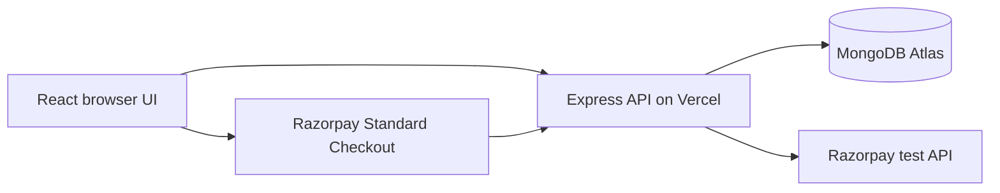

# BorrowLab

**Good things are better shared.** Shared equipment booking for campus labs, clubs, and creative teams. Built by **Atharva Singh**.

[Vercel application](https://borrowlab-mern.vercel.app) · [GitHub and development history](https://github.com/AVsolos/mern-endterm) · [Architecture](docs/product-and-architecture.md) · [Verification](docs/verification.md) · [Demo script](docs/demo-script.md)

## Demo link
https://drive.google.com/file/d/1LQMBgFaOEy_0mL0c9fyCJjIZ6ZtcMGH6/view?usp=sharing

## Problem, users, and solution

Equipment shared through group chats has no reliable availability calendar or handover record. BorrowLab gives managers and student borrowers private workspaces, conflict-safe reservations, a verified test booking fee, and a traceable pickup-to-return workflow.

## Five core workflows

1. Register or sign in; create a workspace with optional sample inventory, or join with an invitation. Managers can rotate invitations.
2. Search and filter equipment, select a time slot, and reserve with a purpose. Overlapping reservations cannot both commit.
3. Pay a server-priced booking fee through **Razorpay test mode**. The server verifies the signature and provider payment before allowing pickup. A status check recovers missed callbacks.
4. Managers check equipment out and record its return and condition. Borrowers can cancel their own uncollected reservations. Overdue loans remain unavailable until returned.
5. Managers add uniquely tagged assets, manage maintenance, and inspect persistent audit history.

Sample assets become ordinary MongoDB records; they are created only when requested. Booking, payment, and user state are not simulated in the application. Only Razorpay money movement uses its test environment.

## MERN stack and architecture

| Layer     | Technology                                                                   |
| --------- | ---------------------------------------------------------------------------- |
| Database  | MongoDB Atlas, official MongoDB Node driver, replica-set transactions        |
| API       | Express 5 on Node.js                                                         |
| Interface | React 19, TypeScript, Vite, CSS, Lucide icons                                |
| Payments  | Razorpay Orders, Standard Checkout, payment fetch/capture, HMAC verification |
| Hosting   | Vercel static frontend and Node API function                                 |
| Tests     | Node test runner, actual isolated MongoDB replica set, Supertest             |



`client/` contains the interface; `server/app.ts` maps HTTP requests to authentication, `server/service.ts` workflows, and `server/payments.ts` verification. `api/index.ts` reuses a MongoDB connection pool in warm Vercel instances. `lib/domain.ts` defines validation and domain types. `tests/` covers permissions, conflicts, transitions, payments, and failures.

## Local setup

Requires Node **22.18+** and a MongoDB Atlas cluster or local replica set. A standalone MongoDB server cannot run the required transactions.

```sh
git clone https://github.com/AVsolos/mern-endterm.git
cd mern-endterm
npm ci
cp .env.example .env
# Fill in your own database and Razorpay TEST credentials.
npm run dev
```

On PowerShell use `Copy-Item .env.example .env`. Open http://127.0.0.1:5173. Express runs on port 3001 and Vite proxies `/api`. Accounts use email/password; no external identity account is required. Use a password of at least 10 characters. Database indexes initialize on connection.

```sh
npm run typecheck
npm test
npm run build
```

Tests start an isolated local MongoDB replica set and never use the Atlas credentials. The first run downloads a MongoDB binary and needs internet access. For a standalone production Node server, build first and run `npm start` with production HTTPS origin configuration.

## Environment variables

Keep `.env` ignored. Never put credentials in `VITE_*` variables, frontend code, or Git.

| Variable                                               | Purpose                                                             |
| ------------------------------------------------------ | ------------------------------------------------------------------- |
| `MONGODB_URI`                                          | Full connection URI; alternatively set the three fields below       |
| `MONGODB_HOST`, `MONGODB_USERNAME`, `MONGODB_PASSWORD` | Atlas hostname and database user credentials; encoded by the server |
| `MONGODB_DB`                                           | Database name, default `borrowlab`                                  |
| `RAZORPAY_KEY_ID`, `RAZORPAY_KEY_SECRET`               | Test credentials only; live keys are rejected                       |
| `RAZORPAY_WEBHOOK_SECRET`                              | Optional separate signing secret for `payment.captured` webhooks    |
| `BOOKING_FEE_PAISE`                                    | Integer fee, default `10000` (INR 100)                              |
| `APP_ORIGIN`                                           | Exact browser origin; local default `http://127.0.0.1:5173`         |
| `PORT`                                                 | Standalone Express port, default `3001`                             |
| `NODE_ENV`                                             | Use `production` for secure cookies and HTTPS origin enforcement    |

On Vercel, omit the local `APP_ORIGIN`: the server derives the production domain from `VERCEL_PROJECT_PRODUCTION_URL` and preview origin from `VERCEL_URL`. For a custom domain, set `APP_ORIGIN` to its exact HTTPS origin. Set MongoDB and Razorpay variables as sensitive server environment variables. Atlas network access must permit the deployment's outbound traffic.

## Vercel deployment

Import this repository into Vercel using the **Vite** preset, repository root, `npm run build`, and `dist` output. `vercel.json` routes `/api/*` to the shared Express function. Configure the variables above, then deploy. Set production deployment access to public so evaluators can reach the sign-in page; app workspace data remains authenticated and membership-protected. Git auto-deploy requires the Vercel GitHub integration. Direct source deployments are also supported.

Verify `/api/health` returns `database: mongodb`, register a fresh account, reserve and pay in test mode, check out and return, then reload. Do not treat a successful frontend build as proof of database connectivity. Final URL and release evidence are recorded in [submission details](docs/submission-details.md).

Optional webhook: configure Razorpay test dashboard to send `payment.captured` to `https://YOUR_DOMAIN/api/payments/webhook`, with the same separate signing secret. Browser verification and **Check payment status** work without webhook setup.

## Evaluator walkthrough

Register, create a workspace with samples, and reserve a camera with pickup five minutes ahead and return two hours later. Open Reservations: equipment checkout is blocked while unpaid. Click **Pay INR 100 - test**, complete Razorpay's test flow, then check out and return with a condition note. Inspect History and Activity and reload. Use a second account and invitation to verify borrower permissions.

## Security, scope, and limitations

Passwords use salted scrypt; opaque session tokens are stored as hashes, expire after seven days, and travel in HttpOnly cookies (Secure in production). Mutations require the expected origin and JSON. Every operation checks workspace membership and manager/borrower permissions. Payment amounts come from saved server state; duplicate callbacks and lost order responses are handled. Mutations and audit records share MongoDB transactions.

Rate limiting is per Node instance, so it is not a distributed abuse defense on Vercel. This student project has no email verification, password reset, real-money billing, refunds, recurring payments, or notifications. Lists show at most 250 recent reservations; availability checks all active bookings. Browser timezone controls displayed times.

## Originality and development

BorrowLab's product workflows and interface were developed for this submission with AI assistance. The initial history used a Sites/Vinext/D1 scaffold. After the student's explicit MERN requirement, the runtime, persistence, and authentication were replaced with MongoDB, Express, React, and Node. No initial MongoDB connection was claimed by that old implementation. The obsolete Sites build is not the final release. Open-source dependencies are recorded in `package.json` and its lockfile.

A demo script is provided, but a script is not a recorded video. The final demo video and official submission form remain separate delivery requirements; see [checklist](docs/submission-checklist.md).
